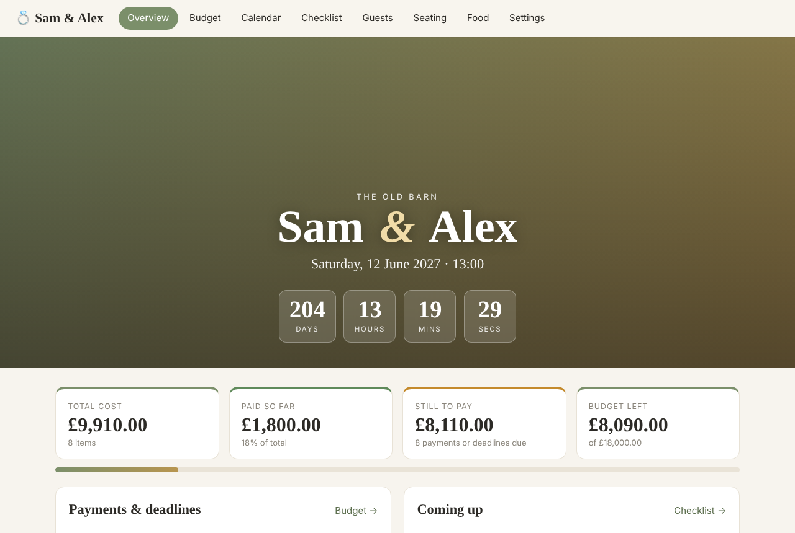
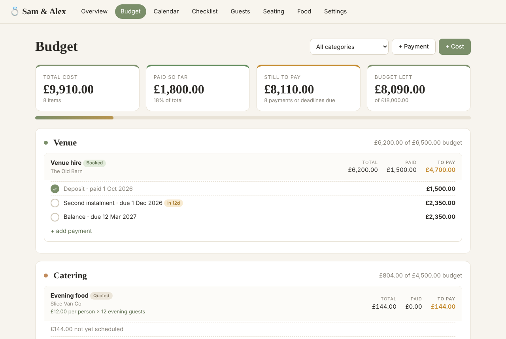
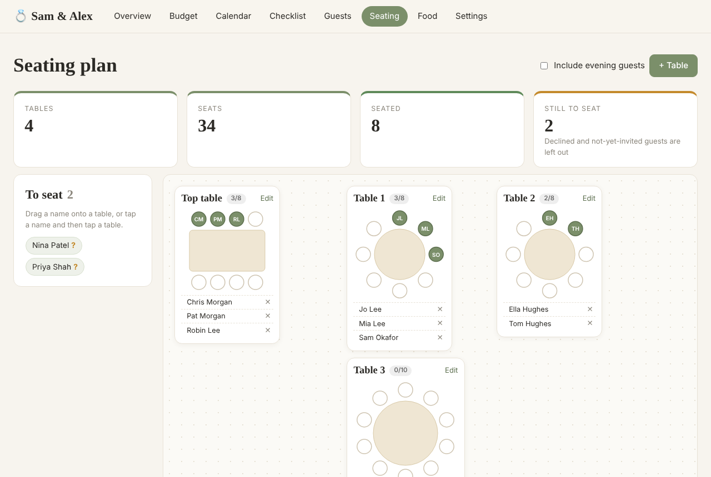
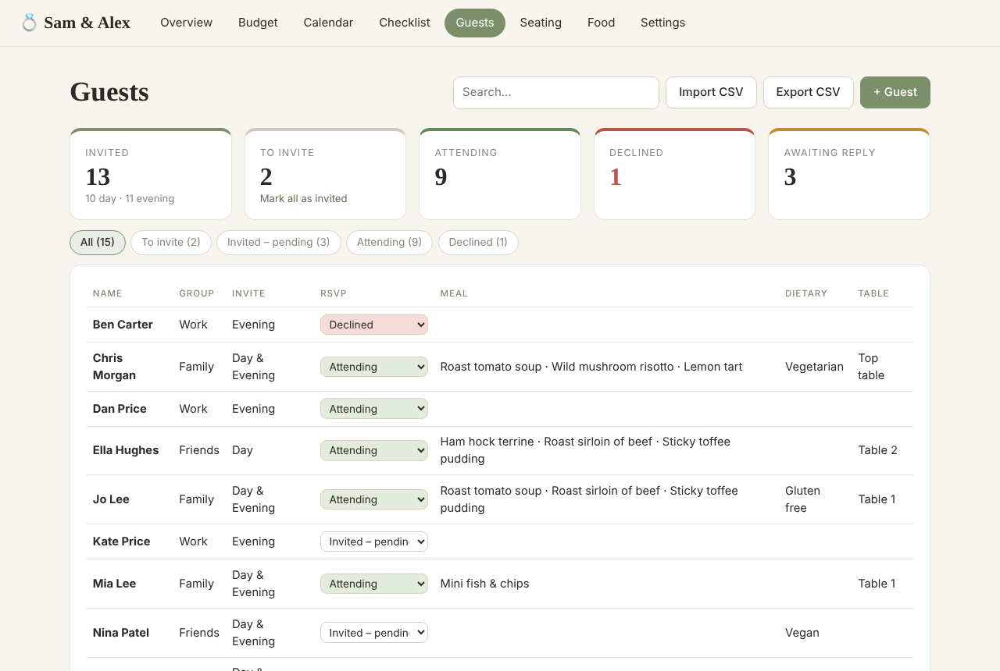
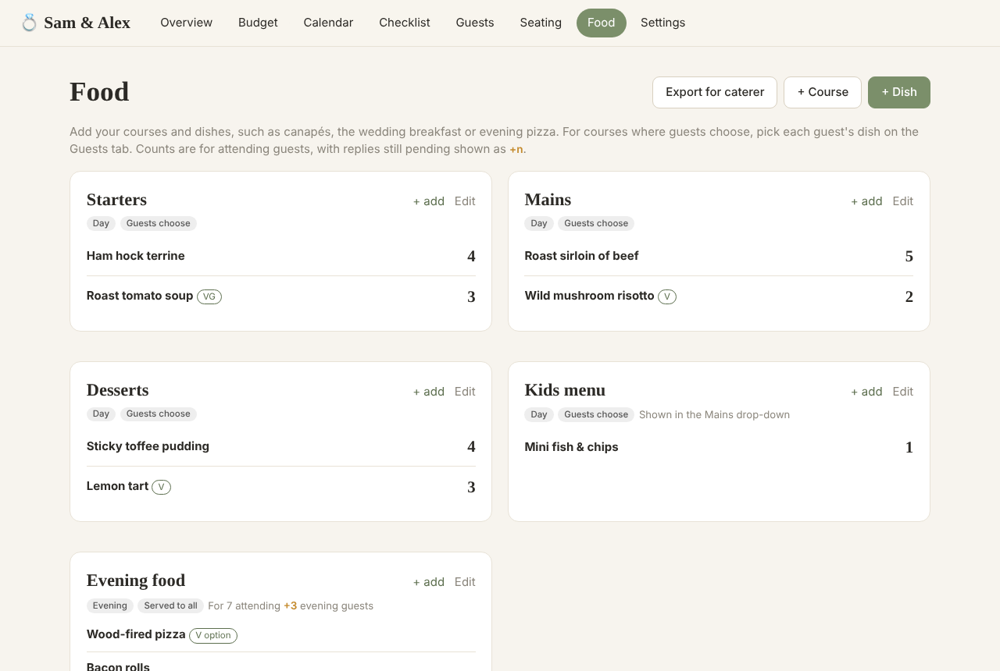

# 💍 Big Barn Day

A lightweight, self-hosted wedding planner for UK weddings. Prices are in pounds (£) and dates are in UK format.

It runs as a single Docker container. Your data stays on your server, in a single SQLite file.



## Features

- **Overview**: header photo, live countdown, budget totals, next payments, upcoming tasks, spend by category and guest numbers.
- **Budget**: costs grouped into categories. Each cost can have a **pay-by deadline**, its own **payment schedule** (deposit, instalments, final balance), or both. Deadlines work even before you know the price. Costs can also be **priced per person**, for example £45 per day guest, £12.50 × 80 for an evening buffet, or a £2 upgrade for each guest who chose a particular dish. These totals update automatically as your guest list and meal choices change. It tracks the total cost, what's been paid, what's still to pay and what isn't scheduled yet, plus a budget for each category with warnings when you go over. Drag categories into whatever order you like.
- **Calendar**: a month view of tasks, payments and deadlines. It also provides a private **iCal feed** you can subscribe to from Google Calendar, Apple Calendar or Outlook.
- **Checklist**: a ready-made UK wedding timeline (giving notice of marriage, booking registrars, save the dates, final numbers and more), dated back from your wedding day. You can edit all of it.
- **Guests**: RSVP tracking from *To invite* → *Invited – pending* → *Attending* / *Declined*, with filters and a one-click **Mark all as invited** for when the invitations go out. Guests not yet invited stay out of the invited numbers, the seating plan and the caterer counts. Day / Evening / Day & Evening invites, meal choices from drop-downs, dietary requirements and tables. **CSV import** works with most spreadsheet layouts and understands headings like *First name*, *Surname*, *RSVP*, *Main* and *Table*. **CSV export** too.
- **Seating plan**: add **round or rectangular tables** with any number of seats. Drag guests onto tables, or tap a guest and then a table on a phone, and drag tables around the room. Each seat shows who is sitting in it.
- **Food**: starters, mains, desserts and a kids' menu to begin with, and you can **add your own courses**, such as canapés, entrées or evening food. Mark each course as day or evening, and as either served to everyone or chosen by each guest (chosen courses get their own drop-down on the guest form). You get live counts of each dish, a list of who still needs to choose, all dietary requirements in one place, and a **caterer export** (CSV).
- **Setup wizard**: the first time it starts, the app asks for both partners' names, the wedding date and the venue. If you give the venue's website, it **pulls a photo from it automatically** for the header. You then pick your budget categories (the common ones are already ticked) and choose what else to start with: the checklist, plus optional example costs and guests, which one click removes later.
- **Settings**: names, date, venue and budget, a header photo upload, one-click removal of example data, and a JSON backup you can download and restore. If you change the date, it offers to move your checklist to match.
- **Optional password**: turn it on, change it or remove it in Settings. Each device stays signed in for 90 days.

Built with Python (Flask), SQLite and plain JavaScript. There's no build step.

| Budget | Seating plan |
|---|---|
|  |  |
| **Guests** | **Food** |
|  |  |

*Screenshots use made-up demo data.*

## Quick start (Docker Compose)

You need Docker with Compose. Images are published for `linux/amd64` (most PCs and mini PCs) and `linux/arm64` (Raspberry Pi 4/5, Apple silicon).

```yaml
services:
  big-barn-day:
    image: ghcr.io/ashstancill/big-barn-day:latest
    container_name: big-barn-day
    restart: unless-stopped
    user: "1000:1000"
    ports:
      - "8714:8000"
    environment:
      - TZ=Europe/London
    volumes:
      - ./data:/data
```

```bash
mkdir -p data          # create it first, so the container user (1000) owns it
docker compose up -d
```

Then open `http://<your-server>:8714`. The setup wizard runs the first time you visit.

## Configuration

| Variable | Description |
|---|---|
| `APP_PASSWORD` | Optional. Sets the password in the Docker config and overrides whatever is set in Settings. Most people should leave this out and manage the password in **Settings → Password** instead. |
| `DATA_DIR` | Where the data is stored inside the container. The default is `/data`. |
| `TZ` | Time zone, for example `Europe/London`. |

## Data and backups

Everything lives in the mounted `/data` folder:

- `wedding.db`: the SQLite database
- `uploads/`: the header photo, either uploaded or fetched from the venue's website
- `secret.key`: used to sign login sessions and the calendar feed link

To back up, copy that folder somewhere safe. You can also use **Settings → Download backup** to get everything as one JSON file, and restore it from the same page.

Keep the data folder on local storage rather than a network share, because SQLite doesn't cope well with network file systems.

## Privacy

Everything you enter is stored only in your `/data` folder. There's no account, no analytics and no tracking. The app only connects to the internet:

- to load its fonts from Google Fonts (without internet it falls back to your device's fonts)
- when you ask it to fetch a photo from your venue's website

The app is designed for a home network or a private VPN. If you expose it to the internet, put it behind HTTPS and turn on a password.

## Venue photo

When you give the venue's website, the server downloads the page and picks its main photo. It looks first for the page's preview image (`og:image` and similar), and otherwise for the first large photo on the page, skipping logos and icons. It then saves a local copy, so the header keeps working even if the venue's website changes. If it picks the wrong image, upload your own in **Settings**. This needs the container to have outbound internet access.

## Calendar feed

**Calendar → Add to your phone's calendar** shows a private subscription link. Whatever device or service subscribes to it has to be able to reach your server. Note that Google Calendar fetches feeds from Google's servers, so it can't reach a server that's only on your local network or a VPN.

## Updating

The image is built by GitHub Actions on every push to `main`. To update, pull the latest image and recreate the container. Your data is kept, because it lives in the volume:

```bash
docker compose pull && docker compose up -d
```

## Development

```bash
pip install -r requirements.txt
python app.py        # then open http://localhost:8000
```

Data is written to `./data` (this folder is git-ignored).

## Contributing

Issues and pull requests are welcome. It's deliberately simple: one Python file (`app.py`) and one front-end script (`static/app.js`), with no build tools.

## Licence

[MIT](LICENSE). You're free to use, change and share it.
